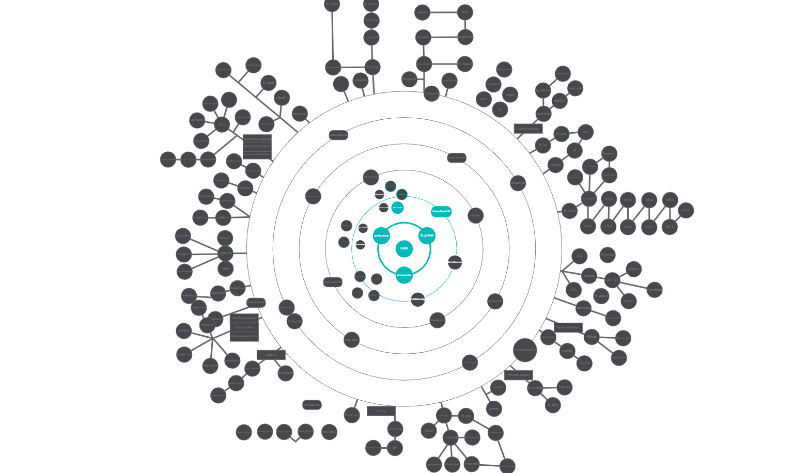

  <picture>
    <source media="(prefers-color-scheme: dark)" srcset="assets/imagenes/42_white.png">
    <source media="(prefers-color-scheme: light)" srcset="https://upload.wikimedia.org/wikipedia/commons/8/8d/42_Logo.svg">
    
  </picture>

# 42 Cursus

*Estos proyectos han sido creados como parte del currículo de 42 por fejimene.*

Este repositorio actúa como el índice central de mi progreso a través del programa de 42. El currículo destaca por su metodología basada íntegramente en el aprendizaje por proyectos (Project-Based Learning), la evaluación entre pares (Peer-to-Peer) y la resolución autónoma de problemas técnicos complejos.

>⚠️ **Nota importante (Work In Progress):** Este repositorio es un proyecto vivo y no definitivo. Su estructura y contenido irán cambiando, evolucionando y ampliándose a medida que se avanza en los distintos Milestones del programa.

## Arquitectura del Repositorio

El directorio está estructurado de manera modular, dividiendo los entregables por niveles de dificultad (*Milestones*) y bibliotecas de uso general.

<table>
  <thead>
    <tr>
      <th align="center">Nivel</th>
      <th align="left">Proyecto</th>
      <th align="center">Estado</th>
      <th align="left">Conceptos Clave</th>
      <th align="center">Lenguaje</th>
    </tr>
  </thead>
  <tbody>
    <tr>
      <td align="center" valign="middle"><kbd>M0</kbd></td>
      <td align="left"><a href="./Libft"><strong>Libft</strong></a></td>
      <td align="center">🟢 Completado</td>
      <td align="left">Memoria dinámica, punteros, listas enlazadas</td>
      <td align="center">C</td>
    </tr>
    <tr>
      <td align="center" valign="middle" rowspan="3"><kbd>M1</kbd></td>
      <td align="left"><a href="./M1/ft_printf"><strong>ft_printf</strong></a></td>
      <td align="center">🟢 Completado</td>
      <td align="left">Funciones variádicas, formateo y parsing</td>
      <td align="center">C</td>
    </tr>
    <tr>
      <td align="left"><a href="./M1/get_next_line"><strong>get_next_line</strong></a></td>
      <td align="center">🟢 Completado</td>
      <td align="left">Descriptores de archivo (FD), variables estáticas</td>
      <td align="center">C</td>
    </tr>
    <tr>
      <td align="left"><a href="https://github.com/jonamunozjim/M1_push_swap.git"><strong>push_swap</strong></a> <em>(Submódulo)</em></td>
      <td align="center">🟢 Completado</td>
      <td align="left">Algoritmos de ordenación, complejidad y optimización</td>
      <td align="center">C</td>
    </tr>
    <tr>
      <td align="center" valign="middle" rowspan="2"><kbd>M2</kbd></td>
      <td align="left"><a href="./M2/Python_Module_00"><strong>Python_Module_00</strong></a></td>
      <td align="center">🟢 Completado</td>
      <td align="left">Sintaxis básica, estructuras de control y tipos</td>
      <td align="center">Python</td>
    </tr>
    <tr>
      <td align="left"><a href="./M2/Python_Module_01"><strong>Python_Module_01</strong></a></td>
      <td align="center">🔵 En curso</td>
      <td align="left">Programación Orientada a Objetos (POO), clases</td>
      <td align="center">Python</td>
    </tr>
    <tr>
      <td align="center" valign="middle"><kbd>Core</kbd></td>
      <td align="left"><a href="./Super_libft"><strong>Super_libft</strong></a></td>
      <td align="center">🟣 Evolutivo</td>
      <td align="left">Biblioteca personal unificada y reutilización de código</td>
      <td align="center">C</td>
    </tr>
  </tbody>
</table>

### Holy Graph

  

## Metodología y Normativa

Todos los proyectos desarrollados en C dentro de este repositorio están estrictamente sujetos a la **Norminette** y estándar de código oficial de 42. Esto implica un cumplimiento riguroso de convenciones que garantizan un código extremadamente limpio y mantenible, incluyendo:

*   Ausencia absoluta de fugas de memoria (Memory Leaks).
*   Funciones con un máximo de 25 líneas.
*   Prohibición de bucles `for`, sentencias `switch` y uso de variables globales.
*   Gestión controlada de dependencias y macros.

## Notas de Compilación y Documentación

Para mantener la raíz del repositorio estructurada, la información técnica específica se incluye en el interior de cada proyecto:

*   **Documentación Individual:** Cada subdirectorio contiene su propio archivo `README.md` con las especificaciones del reto, el enfoque de resolución y notas de la evaluación.
*   **Compilación:** Todo proyecto en C incluye su respectivo `Makefile` estandarizado. Proporciona siempre las reglas base (`make`, `clean`, `fclean`, `re`) para una compilación segura.
*   **Gestión de Dependencias Grupales:** Algunos proyectos de 42 se desarrollan en equipo. Para mantener el historial de *commits* original y el trabajo individual, estos se enlazan en este repositorio general mediante submódulos de Git (visibles en el archivo `.gitmodules`).

## Autor

- [Félix Jiménez](https://github.com/fexjizcas)